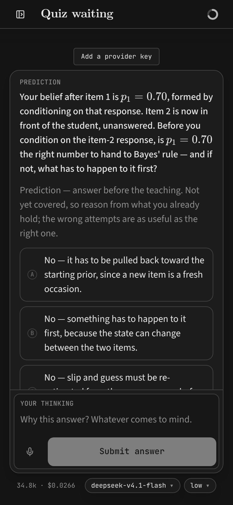
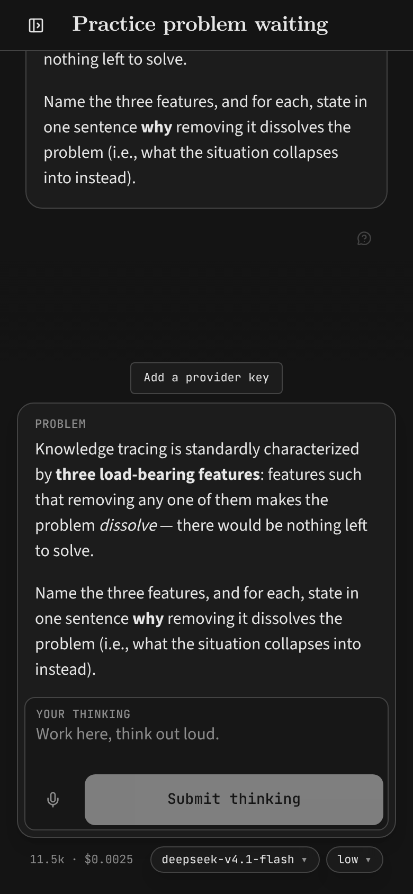
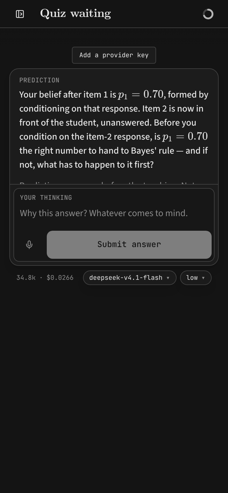
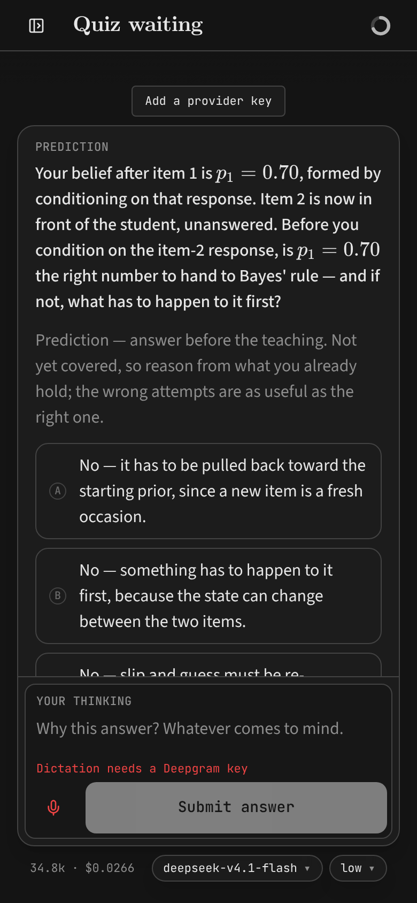
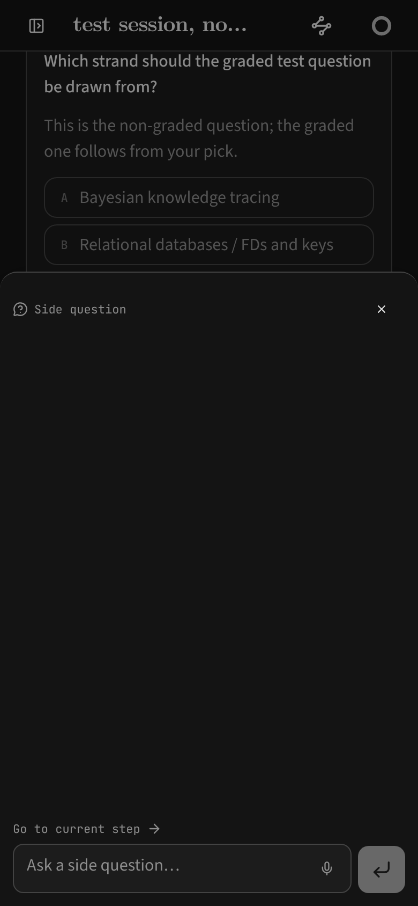
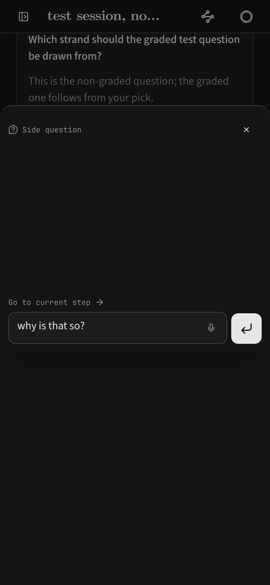

# LearnHarness on a phone: the answer docks, the side question and the on-screen keyboard (as built)

2026-11-22 · Thomson Simplify · story 5b of the [combined plan](combined-plan.md) · design in [phone-layouts.md](phone-layouts.md) (sections D to F) · builds on [phone-shell.md](phone-shell.md) and [touch-input.md](touch-input.md)

This story makes answering a question, working a practice problem and asking a side question comfortable on a phone. It does the least that gets there: the question and practice docks already behave like a sheet (they sit at the bottom, the question scrolls, and "Your thinking" and Submit stay pinned), so they are kept, and what was missing is made up. The page now follows the on-screen keyboard, Submit is a full-width 48px button with a microphone beside it, and the side question is a real bottom sheet.

## What changed

- **The screen follows the keyboard** (`lib/visual-viewport.ts`, used by the shell in `components/sidebar.tsx`). A phone's keyboard does not shrink the page: iOS and Chrome on Android shrink the *visual* viewport and leave the layout alone, so everything anchored to the bottom, the composer and the answer docks, ended up behind the keyboard. A keyboard is the visual viewport being 100px or more shorter than the layout viewport; where iOS has panned the page to show the field makes no difference to that (it pans just far enough to show the field, which can leave the bottom of the page under the keyboard). While a keyboard is up the page sets `--lh-vvh` (the visible height) and `--lh-vv-top` (the visual viewport's `offsetTop`, how far the page has been panned) on `<html>`, plus `data-lh-keyboard`. The app shell is `height: var(--lh-vvh, 100dvh)` at `top: var(--lh-vv-top, 0px)`, and `position: fixed` while the keyboard is up (`offsetTop` is measured from the layout viewport, so a fixed shell stays right even if the page has scrolled), so it is exactly the part of the screen the keyboard leaves, and everything in it, the dock's height budget included, simply fits. The home-indicator padding goes while the keyboard covers it. A pinch-zoomed page is not a keyboard. With no keyboard nothing is set and the shell is `100dvh` at the top in normal flow, as in story 4. It runs on touch screens only (`(pointer: coarse)`), so a computer is untouched, and tablets get it too.
- **The answer docks' footer on a phone** (`question-dock.tsx` for quiz, ask, probe, explain and recall; `practice-dock.tsx`; `plugin-question-dock.tsx`): a **full-width 48px Submit** (it was 36px, right-aligned), the **microphone** (44px) to its left, the "↵ new line" hint hidden, and "Your thinking" starts as one 44px row. If dictation fails, the reason is a red line above the footer, as in story 5a. The session shares its dictation with the docks through `DockDictationContext` (`components/dictation.tsx`), so a dock can show the mic without it being passed down through every layer.
- **The side question is a bottom sheet on a phone** (`components/side-thread.tsx`): the lower 70% of what the screen shows, over a dimmed lesson, full width, rounded top corners, above the keyboard when it is up. Tap the dimmed lesson or ✕ (or press Escape) to close it; the draft is kept. It is a modal dialog for a screen reader (`aria-modal`), focus is inside it while it is open and goes back to where it was when it closes. There is no pin, float, drag or resize on a phone (the floating window and the docked 22rem panel are not used below 768px), the ✕ and Send buttons are 44px, the microphone in the field is 36px, and the field is 16px so iOS does not zoom when it takes focus. It is the same conversation, header and field as before (`SideThreadBody`); only the frame around it changes.

Nothing changes at 768px or wider or in the desktop app. What makes the phone footer, the mic and the sheet appear is the width (under 768px, not the desktop app), the same `phone:` variant as story 4, so a narrow browser window with a mouse gets them too; touch is what turns on the keyboard-following shell (and, from story 5a, Enter as a new line and the finger-sized touch areas). On a tablet (touch, 768px or wider) the side question stays the floating window or the docked panel, the docks keep their 36px Submit, and only the keyboard-following shell applies.

## Where the code is

- `lib/visual-viewport.ts`: `visibleArea(reading)` (pure: what a keyboard leaves, or null) and `installVisualViewportVars(window)`, which keeps the variables in step on the visual viewport's `resize` and `scroll` events, one update per frame, and returns its cleanup.
- `components/sidebar.tsx`: the shell's classes (`relative top-[var(--lh-vv-top,0px)] flex h-[var(--lh-vvh,100dvh)] … [html[data-lh-keyboard]_&]:pb-0`) and the one effect that installs the variables.
- `components/dictation.tsx`: `DockDictationContext`, `DockMic`, `DockDictationNote`. `components/chat.tsx` provides the context around the dock overlay and gives the docked-panel wrapper its close handler.
- `components/question-dock.tsx`, `practice-dock.tsx`, `plugin-question-dock.tsx`: the footer.
- `components/side-thread.tsx`: `SideThreadSheet`; `SideThreadPopover` and `SideThreadPanel` choose the sheet on a phone and the floating window or the panel otherwise.
- `tests/bottom-sheets.test.tsx` (26 tests).

## Trying it

On a computer, as in [phone-shell.md](phone-shell.md): check out the branch, `npm run dev`, and open DevTools' device toolbar at 390 by 844 **with touch on** (the width is what shows the sheet and the mic; touch is what a real phone has and what turns on the keyboard-following screen), then reload.

1. Open a session with a waiting question or problem (a quiz from the teacher, or a practice problem). The dock sits at the bottom, the question scrolls inside it, and "Your thinking" and a wide **Submit** stay in view. The microphone is left of Submit.
2. Tap the microphone with no Deepgram key: the reason appears above Submit; tap again and Settings opens at the keys.
3. In a teaching session, tap the small side-question icon after a reply: a sheet rises from the bottom over a dimmed lesson. Type; tap the dimmed lesson or ✕ to close, and open it again: the draft is still there. Widen the window past 768px: it is the floating window again.
4. **The keyboard.** DevTools' device toolbar has no on-screen keyboard, so there are two ways to see it. On a real phone (needs the HTTPS address from story 8), tap "Your thinking" or the side question's field: the app is then only the part of the screen above the keyboard, with Submit or Send right above it. On a computer, pretend a keyboard is up by setting what the app would set: in the console run `document.documentElement.style.setProperty('--lh-vvh', '508px'); document.documentElement.dataset.lhKeyboard = ''` and the page shrinks to 508px, with the dock and the sheet fitted above the bottom edge; run `document.documentElement.style.removeProperty('--lh-vvh'); delete document.documentElement.dataset.lhKeyboard` to go back. (This shows what the layout does with a keyboard; it does not test the phone's own behaviour, which is in "Not checked" below.)

## Checked

See the story's pull request for the exact runs. In short: 27 new tests, and 72 checks in Chromium at 390 by 844 with touch against the production build, where the keyboard is a stand-in for `window.visualViewport` that the test moves (a real keyboard was not available): in the quiz, ask and practice docks Submit is 48px tall and fills the row beside a 44px mic, the hint is hidden, and "Your thinking" is a 44px row; with a 508px visible area the page sets the variables, the shell is exactly 508px tall, the padding is dropped and Submit is inside the visible area with nothing over it; panned 120, 200, 250 or 336px (iOS pans just far enough to show the field, which can leave the bottom of the page under the keyboard) it is still a keyboard, the shell is fixed to the screen at that offset and Submit is inside the visible area and tappable; a 54px shrink (the browser's own bars) is not a keyboard, panned or not; closing the keyboard unsets everything and puts the shell back in normal flow; the side question is a sheet of 591px (70% of 844) at the bottom, full width, over a backdrop, with a 44px ✕ and Send, no pin, a 16px field; with a keyboard it is 356px tall and its bottom is at 508; a tap on the backdrop closes it and the draft is kept; the sheet is a modal dialog, focus is in its field, Escape closes it from the Close button and from the field, and focus returns to the button that opened it; a computer and a tablet get the floating window and the 36px Submit; the desktop app's user agent keeps its layout.

Not checked: a real iPhone or Android phone with a real keyboard. That means how iOS pans the page when a field takes focus (the shell follows `visualViewport.offsetTop`, but the timing of iOS's own scrolling was not seen), the keyboard's height changing while it opens, the Android keyboard in the home-screen app, a keyboard with a suggestion bar, and the microphone permission prompt.

## Open points

- **A phone held sideways** is 844px wide, so it gets the computer layout (story 4's question). With a keyboard up there is about 190px of screen: the dock then shows a strip of about 40px that scrolls inside itself. Hiding the header while the keyboard is up, or giving landscape phones the phone layout, would help; neither is done.
- **Pulling the sheets.** The design sketched "pull down to collapse" for the docks and "pull up for full screen" for the side question. Not built: the docks already fold to a bar when you scroll the transcript, and the sheet closes with ✕ or a tap outside. Say so if you want the gestures.
- **A two-line summary of the question above "Your thinking" while typing** (the design's "pins a two-line summary") is not built. The question scrolls above the field instead.
- **The side-question sheet is fixed at 70% of the visible screen.** It does not grow with a long conversation, which scrolls inside it.
- **Pop-ups outside the app shell** (the dialogs of the settings and rename forms, the drawer, toasts) are anchored to the whole layout viewport, not the part the keyboard leaves, so with a keyboard up they can have their lower part behind it. Story 6 looks at the dialogs one by one.
