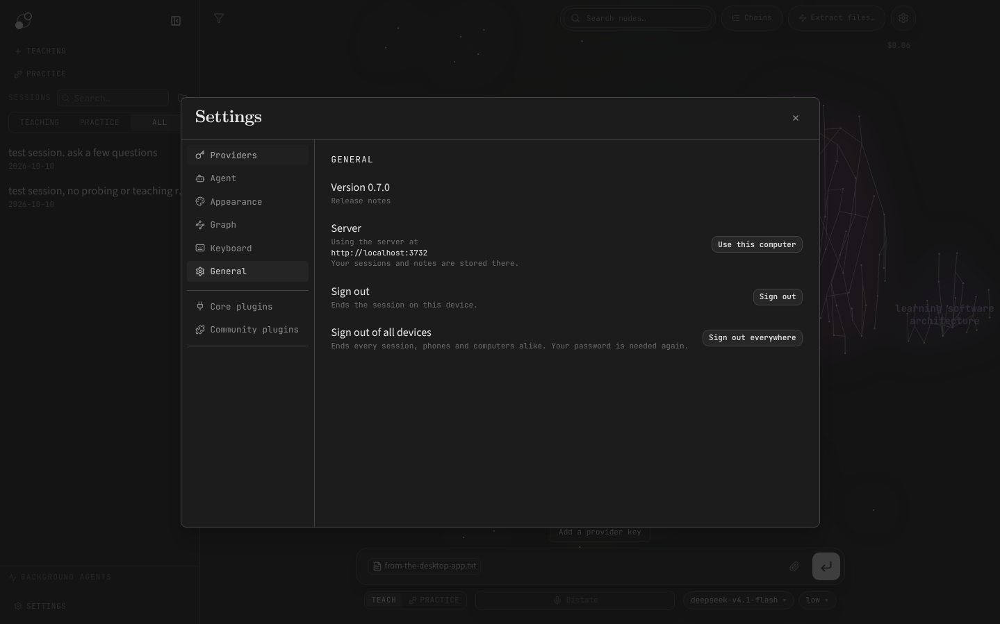
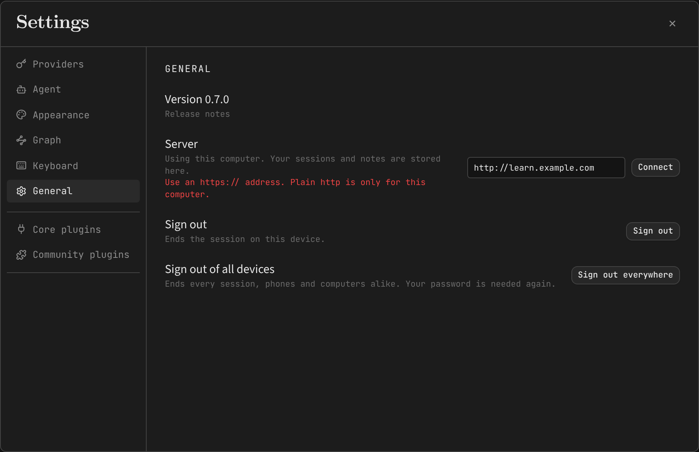

# The desktop app with a server (as built)

2026-11-22 · Thomson Simplify · story 7 of the [combined plan](combined-plan.md) · builds on [login.md](login.md) and [uploads.md](uploads.md)

Settings → General has a new **Server** row. Leave it alone and the desktop app works as it always has: it starts its own server on this computer and keeps your sessions here. Type the address of your hosted server (for example `https://learn.heythomson.com`) and the app stops starting a server of its own and opens that address in its window. You sign in on the same login page as on the phone, and you see the same sessions, notes and graph, because they are stored on the server.

Nothing is copied when you switch. Your sessions on this computer stay where they are and stop being used; moving them to the server is a separate step (the runbook in story 8).

## Using it

1. Open Settings → General. The **Server** row says "Using this computer. Your sessions and notes are stored here." and has a field for the server's address.
2. Type the address (`learn.example.com` is enough, `https://` is added) and press **Connect**. A native confirmation appears: "Use the server at https://learn.example.com?" It says the app restarts, that you sign in there and see what is stored on it, and that nothing is copied. The default button is **Cancel**; **Switch and Restart** goes ahead.
3. The app restarts and opens the server's login page. Sign in as you do on a phone.
4. To go back, open Settings → General → Server and press **Use this computer** (confirm "Use This Computer and Restart"). If the server is down and Settings cannot load, the app menu (the LearnHarness menu on a Mac) has **Use This Computer Instead of the Server…**.

What the box accepts: an address with `https://` (or without it, which means https). Plain `http://` is accepted only for this computer (`localhost`, `127.0.0.1`, `[::1]`), so you can try the feature without hosting anything. A path, query or fragment is dropped (the app always opens the root). A user name or password in the address, any scheme other than http and https (and a slip such as `http:/`, which would otherwise become a host called "http"), a space or line break inside, and port 0 are refused with a message in the row, and no dialog opens. If the choice is confirmed but cannot be saved (the app's data folder cannot be written), the row says so and the app does not restart.

## What switches off while a server is in use

The app starts no server on this computer, so everything that assumed one is gone or goes through the server:

| Feature | With a server |
| --- | --- |
| Your sessions, notes, graph, settings and API keys | Stored on the server. The data folder on this computer is not read or written. |
| Attaching a file or a folder | The folder picker and dropped file paths work only for a server on the same computer, so they are off: Attach opens the system file picker and **uploads** the file to the server (story 3), as in a browser. |
| ChatGPT, GitHub Copilot and Grok subscription sign-in | The desktop bridges are off; the Providers section uses the same web connections a browser uses, which go through the server. (The plan uses API keys only.) |
| Checking a demo in a browser | The app's own Chromium helper is started by the local server, so with no local server it is not started. The hosted server uses its own Chrome (story 8). |
| The desktop secret | Not created and never sent. Every request still has the `x-learnharness-desktop` header stripped, so a page cannot set it either. |
| Window controls, zoom, appearance, update checks, the Settings menu item | Unchanged. |

## If the server does not answer

At launch the app waits up to 10 seconds for the address. If nothing answers, it shows "Can't reach <address>" with **Try Again**, **Use This Computer** (restarts the app on this computer) and **Quit**. It never opens an empty window. (If **Use This Computer** cannot be saved, an error box says so and the question comes back.)

## Safety

- **https only**, except for this computer.
- **No secret leaves the app.** In server mode no desktop secret exists, and the header hook that strips `x-learnharness-desktop` from every request stays on. In a real Electron window pointed at a server through a logging proxy, 55 requests went out (24 of them to `/api`) and none carried the header.
- **A web page cannot change the setting by itself.** The `lh:server:set` channel is accepted only from the app's own window (trusted window and sender), validates the address again in the main process, and always ends in the native confirmation with Cancel as the default button.
- **Only the origin is stored**, in `server.json` in the app's data folder (mode 0600, written to a temporary file and renamed). A file that is there but unusable is ignored, and the reason goes to `logs/main.log`, so the app still starts.
- **The page is the server's page.** Pointing the app at a server means trusting that server with the window, as with any site in a browser. The bridge the page gets in this mode is: window controls and zoom, the platform name, appearance, checking for updates, reading the update state and (once one is downloaded) restarting to install it, the startup message, the Settings shortcut and the server setting; not the folder picker, file paths or the subscription sign-ins. A page from the server can therefore ask for an update the app has already downloaded to be installed, but cannot download or choose one.
- **A page can ask, never answer.** It can call the switch question as often as it likes (after you press Cancel it can ask again), but the question is a native dialog it cannot press. The app menu's **Use This Computer Instead of the Server…** is the way out if a page keeps asking; if one question is open, the menu item waits for it.
- **The development shell** (`LH_DEV_URL`, used by `npm run desktop:dev`) ignores the setting and always uses its own server.

## Where the code is

- `electron/server-setting.cjs` (new, pure, no Electron import): `normalizeServerAddress`, `readServerSetting`, `writeServerSetting`, the window argument `--lh-server=<mode>` and the two native prompts.
- `electron/main.cjs`: reads the setting once in `main()`; in server mode starts no child server and no ChatGPT or subscription bridge, creates no desktop secret, waits for the address (`serverAnswers`) and opens it; the `lh:server:get` and `lh:server:set` handlers; `askToSwitchServer` and `relaunchWithServer`; the app-menu item; the `lh:attachment:pick` handler is registered only when the app runs its own server, so in server mode nothing answers that channel.
- `electron/preload.cjs`: reads the mode from the window argument; in server mode leaves out `getPathForFile`, `chooseAttachmentFolder`, `chatgpt` and `subscriptions` (the renderer keys each feature on the member being there, so it falls back to uploads and the web connections); adds `server: { get, set }`.
- `components/settings/server-settings.tsx` (new), rendered in `components/settings/settings-dialog.tsx` between the update rows and the sign-out rows; the `Window.lh.server` type in `components/sidebar.tsx`.
- `tests/server-setting.test.ts` (16), `tests/server-mode-preload.test.ts` (5), `tests/desktop-server-mode.test.ts` (19, runs the real `main.cjs` in a sandbox with a fake Electron), `tests/server-settings.test.tsx` (8).

## Trying it without AWS

You need a server and the desktop app, both on this computer. This is how the checks for this story were run, with a password on the server so the login page is part of it.

```bash
git fetch origin && git checkout claude/mobile-s7-desktop-server
npm ci && npm run plugins:setup && npm run build

# 1. A server: the same browser-mode server that story 8 puts on AWS, here on localhost.
export LH_DATA_DIR="$(mktemp -d)" LH_AUTH_FILE="$(mktemp -d)/auth.json" LH_ALLOWED_HOSTS=localhost
cp -r tests/fixtures/golden-data/. "$LH_DATA_DIR"/          # two sessions to look at
echo 'a-password-for-trying' | npm run access --silent -- set-password --stdin
npx next start -H localhost -p 3000                          # leave it running

# 2. In a second terminal: the desktop app, with a scratch data folder (your real app's data is untouched),
#    told to use that server. --user-data-dir is what keeps the two apart.
SCRATCH="$(mktemp -d)"
printf '{"address":"http://localhost:3000"}\n' > "$SCRATCH/server.json"
npx electron . --user-data-dir="$SCRATCH"
```

The window opens the server's login page (sign in with the password above), then the app as usual. Open Settings → General: the Server row says "Connected to http://localhost:3000" and offers **Use this computer**. Things to try:

- Attach a file in a session: the system file picker opens and the file is uploaded to the server; there is no folder picker.
- Stop the server and start the app again: after about 10 seconds a dialog says "Can't reach http://localhost:3000" with Try Again, Use This Computer and Quit. Start the server and press Try Again: the app opens.
- Look in `logs/main.log` under `$SCRATCH`: the app logs "using the server at http://localhost:3000" and never "starting server".
- Press **Use this computer** and confirm: the app restarts and `server.json` is gone. An unpackaged `electron .` has no server of its own to start (only the packaged app has one), so the restarted app cannot start and `main.log` ends with a spawn error: quit it. In the packaged app it opens on this computer's own sessions.

The other state of the row, the address box with **Connect**, appears only when the app is on this computer, which an unpackaged run cannot be. A packaged app shows it, and the picture below shows it too.

## What it looks like

The real Electron app (unpackaged, under a virtual display), pointed at a server. The file in the composer was picked in the app and uploaded to the server:



The row when the app is on this computer: the address box and **Connect**, here after typing a plain-http address. A packaged app is needed to see this for real, so this picture is the same production page in a browser with a stand-in for the desktop bridge:



## Checked

Real Electron, unpackaged, under a virtual display on Linux, against a production build of this branch with a password set (both scripts are described in the pull request):

- **Pointed at a server** (16 checks). The window opens the saved address and the login page works inside Electron. The bridge says `remote` at that address, has no folder picker, path resolver, ChatGPT or subscriptions, and keeps the window controls, zoom, update and Settings members. It refuses plain http to another host, an empty box and the address already in use, without asking anything. Attach is the browser's file picker (no "files or folder" menu), and a picked file is uploaded (`POST /api/uploads` answered 201; the file shows in the composer in the first picture below). Settings → General has the Server row with **Use this computer**. Through a logging proxy 55 requests went out, 24 of them to `/api`, and none carried the desktop header. `main.log` says "using the server at …" and never "starting server". A saved address that does not answer is logged as unreachable and no window is opened.
- **Switching back** (7 checks). Pressing **Use this computer** asks the native confirmation once, with Cancel as the default button (a stand-in answered it, because nobody can click a dialog on a virtual display). Then the app quits, `server.json` is gone, and a new instance starts with the same command line (`--user-data-dir` kept) in this-computer mode: `main.log` says "starting server" and does not use the old address again. That new instance then fails to spawn a server, because an unpackaged app has none; that is the unpackaged app's own limit, not the switch.
- **Tests**: 48 new tests in four files (16 + 5 + 19 + 8) and one existing assertion brought up to date (a normal window now carries `--lh-server=local`, in `tests/desktop-platform.test.ts`). Each of 44 deliberate breaks of the code was caught by at least one of them. `tsc` is clean, `eslint` has no errors, `next build` passes. The whole suite on the merged branch: 5,868 tests, 5,857 pass. The 6 that fail and the 1 file the runner cancelled are this sandbox's known failures (it runs Node 22, CI runs Node 26), in code this story does not touch: a tooltip timing test, the plugin document proxy, three safe-fetch tests, one subscription sign-in test, and the whole `tests/safe-fetch.test.ts` file.

**Not checked.** The packaged and signed app on macOS or Windows. **Connect** → confirmation → restart in a real window (an unpackaged run has no this-computer mode to start from; the same code is covered with a fake Electron in `tests/desktop-server-mode.test.ts`, and the mirror image, switching back, is the second check above). The words "Restarting…" in a real window (the window closes too fast to see them; the component test covers them). A hosted server with real HTTPS and a real domain (story 8).

## Open points

- **Automatic updates.** The "Automatic updates" switch in Settings is stored on whichever server is in use, but the desktop app's updater reads the copy on this computer. With a server, the switch does not change the desktop updater (automatic checks stay as they were; **Check for Updates…** still works). Fixing it means the main process reading the server's setting.
- **No data copy.** Moving what is on this computer to the server, and back, is story 8's runbook.
- **How you get a build of the fork.** The installed app updates itself from the original project's releases, and `npm run desktop:dist` signs with the original author's Apple team ID. Getting a build of this fork onto your Mac (and keeping it updated) is part of story 8's guide.
- **The "can't reach" check.** It uses the app's Node network stack, not the window's. A server whose certificate only this computer's system trusts (a private or company authority), or that can be reached only through a system proxy, would be reported as unreachable, and Try Again cannot fix that. A public site with a Let's Encrypt certificate, which is what story 8 sets up, is not affected.
- **First paint.** The window's native chrome (title bar colour) comes from the local appearance setting until the server's page reports its own, so a different theme on the server shows for a moment.
- **Not tested here:** a packaged and signed app on macOS or Windows. The checks used the unpackaged app under a virtual display on Linux.
