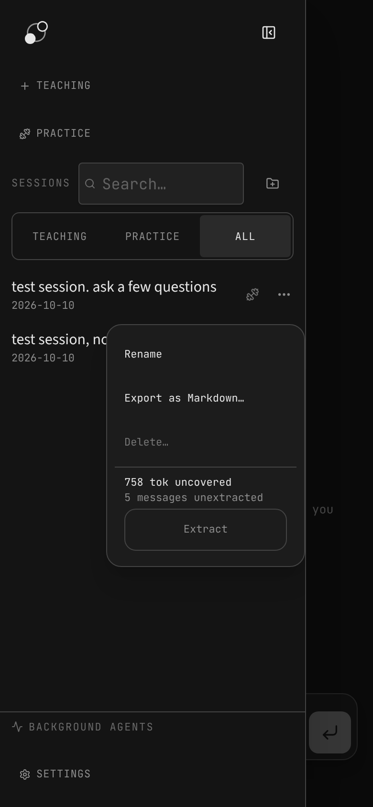
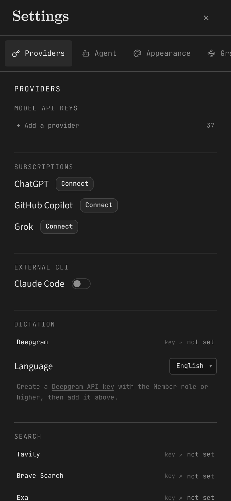
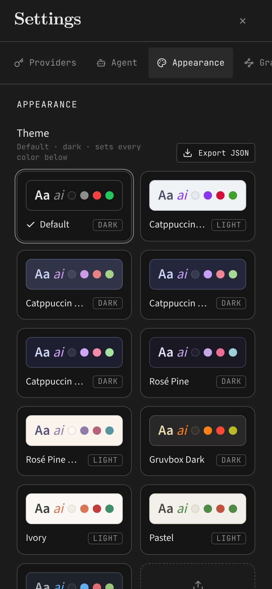
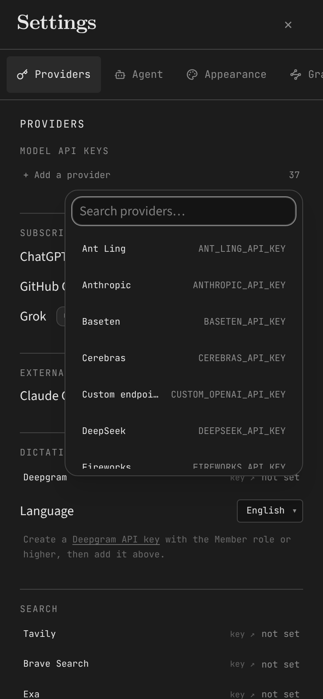
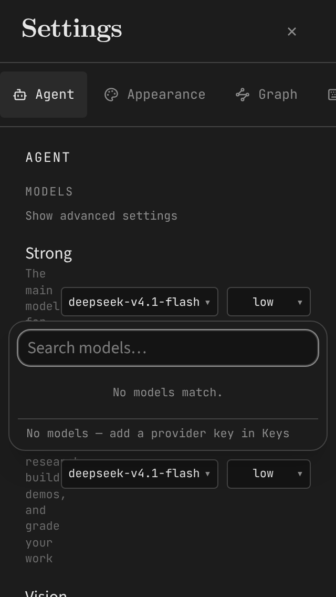
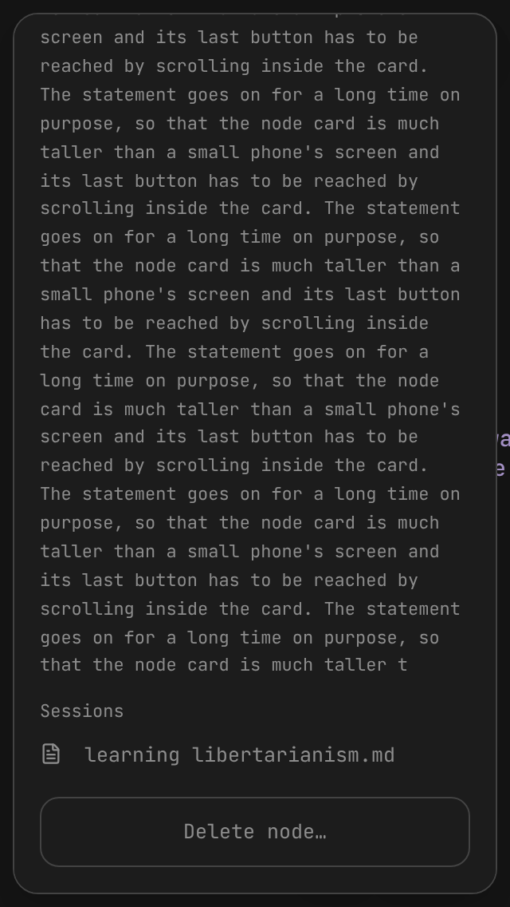

# LearnHarness on a phone: Settings, the row menus, the graph and the chains table (as built)

2026-11-22 · Thomson Simplify · story 6 of the [combined plan](combined-plan.md) · builds on [phone-shell.md](phone-shell.md), [touch-input.md](touch-input.md) and [bottom-sheets.md](bottom-sheets.md)

This story goes over the pages that stories 4 and 5 did not touch, and does the least that makes each of them usable with a finger: what a mouse reaches with a right click gets a visible button, the Settings window fits the screen, and the controls that were too small or off the screen are fixed. It adds no new screens and moves nothing on a computer.

## What the audit found

Every page at 390 by 844, 360 by 640 and 320 by 568, with touch: the graph, a new teaching and a new practice session, a teaching session, a waiting quiz, a waiting practice problem, the Flashcards library, Settings (all eight sections; the first audit also covered the four plugin pages), the delete dialogs and the graph's pop-ups. Two things to know about the method:

- A mobile browser **widens the layout viewport** when something does not fit (`window.innerWidth` becomes 392 on a 360px phone, and the page shows zoomed out). So "nothing scrolls sideways" has to be measured against the phone's real width, not against `innerWidth`; the audit's first pass measured against `innerWidth` and missed the chains table below.
- Everything was fine except what is listed here. The Flashcards library's table is 651px wide and scrolls sideways inside its own box; the page does not move. The plugin editors (coding questions, drawing pad) need a model to open and were not audited.

## What changed

- **Settings is a full-screen window on a phone** (`components/settings/settings-dialog.tsx`). It covers what the screen shows (above the keyboard, with the same `--lh-vv-top` and `--lh-vvh` variables as the shell), with the notch and home-indicator insets as padding (the bottom one drops while the keyboard is up). The eight section buttons and the plugin pages become a **row along the top** that scrolls sideways, 44px tall; the close button is 44px; the dividers between the groups go. In Appearance the theme cards are two across (`theme-cards.tsx`) and the two-column grid is one column (`appearance-section.tsx`). Before, it was a 920px window squeezed to 90% of the screen with a 192px column of sections beside a page 150px wide.
- **A "⋯" button on every session and folder row in the sidebar, on a touch screen** (`components/row-menu-button.tsx`). Rename, Export as Markdown and Delete (and a folder's New subfolder) were reachable only with a right click, which iOS Safari does not send for a touch-and-hold. The button sits over the right end of the row (the row keeps 48px free for it), opens the same menu anchored to itself, and a second tap closes it. It is not there while a row is being renamed, and not at all with a mouse. It draws a ring when a keyboard has focus (a tablet with a keyboard), since the app draws no outline anywhere else. The menu items, and the Extract button in the session menu, are 44px tall on a touch screen.
- **Delete on the graph's node card, on a touch screen** (`components/graph-view.tsx`). A node could only be deleted with a right click on the canvas. The card that opens when you tap a node now ends in a 44px "Delete node…" button that opens the same confirm dialog. A card taller than the graph area (a very long statement on a small phone) now scrolls inside itself, so that button is never off the screen; before, nothing capped the card's height.
- **The chains table fits a phone** (`components/chain-table.tsx`). Its top bar was a fixed 392px wide: at 390 the close button was clipped by 2px, and at 360 and 320 it was **off the screen** (and the whole page widened). Now the counts ("204 chains · 278 nodes") are hidden on a phone, the search field takes the room that is left (152px at 320), and the close and add-folder buttons have a 44px touch area. The selection bar's Clear, Done and Delete buttons do too.
- **Finger-sized controls elsewhere**: the graph's Chains and Extract files buttons; the Cancel and Delete buttons of the delete dialogs for a session, a folder and a node; the rows of the searchable dropdowns (providers, models, thinking levels, dictation language: 27px, now 44px on a touch screen); and the two sign-out buttons in Settings.

- **Text fields are 16px on a touch screen** (`app/globals.css`). iOS Safari zooms the page into any text field whose text is under 16px when it takes focus, and leaves it zoomed until you pinch back out. 20 of the 23 fields on these pages were 11px: the chains search, the key fields, the number and colour boxes in Settings. One rule, outside Tailwind's layers so it beats the per-field `text-xs`, sets every text field to 16px when the main pointer is a finger. A mouse is unchanged. At 320 wide the chains search's placeholder is cut ("Search node"), which is cosmetic.

- **Dropdown menus stay on the screen** (`components/menu-shell.tsx`, the shell every dropdown in the app uses). A menu hangs from its button's right edge, and a button that sits well in from the screen's edge let a wide menu run off the other side: in Settings → Agent the 352px model menu started 74px off the left edge at 390 wide, and 144px at 320, with a third of it cut off. The shell now measures the menu and slides it along the edge to keep an 8px margin, and caps its width to the screen between the margins (a 304px menu at 320). Where a menu fits beside its button, nothing changes. The independent test of this story found it; the other dropdowns (the composer's model and thinking menus, the add-provider menu) use the same shell, so they are covered too.

Nothing changes at 768px or wider with a mouse, or in the desktop app: the "⋯" button and the bigger rows and areas are keyed to `pointer-coarse:` (a finger is the main pointer), so a narrow window with a mouse does not get them; the Settings window and the chains table's bar are keyed to the `phone:` variant (under 768px, not the desktop app), as in story 4.

## Where the code is

- `app/globals.css` (the 16px rule).
- `components/row-menu-button.tsx` (new), used by `components/sidebar.tsx` (session rows, the menu items) and `components/sidebar-folders.tsx` (folder rows: optional `onMenuButton` and `menuOpen`).
- `components/settings/settings-dialog.tsx`, `theme-cards.tsx`, `appearance-section.tsx`, `model-menu.tsx`, `search-menu-list.tsx`, `access-settings.tsx`.
- `components/menu-shell.tsx` (the shared dropdown shell: sideways placement), `components/graph-view.tsx` (node card Delete and its height cap, Chains button), `components/notes-import.tsx` (Extract files button), `components/chain-table.tsx`, `components/extraction-coverage.tsx` (Extract button), `components/delete-node-dialog.tsx`, `components/delete-session-dialog.tsx`.
- `tests/touch-menus.test.tsx` (new, 24 tests), plus 5 in `tests/menu-shell-pure.test.ts` (sideways placement) and one each in `tests/render-chain-table.test.tsx` and `tests/settings-dialog-interaction.test.tsx`.

## Trying it

On a computer, as in [phone-shell.md](phone-shell.md): check out the branch, `npm run dev`, DevTools' device toolbar at 390 by 844 **with touch on** (touch is what turns on the "⋯" button and the bigger areas), reload.

1. Open the drawer. Every session has a **⋯** at its right end. Tap it: the menu opens under it with Rename, Export as Markdown and Delete, 44px tall. Tap it again: it closes. Rename turns the row into a text field. Add a folder (the folder icon by the search field): its row has a ⋯ too, with Rename, New subfolder and Delete.
2. On the graph (home), tap a node (zoom in with a pinch first): its card ends in **Delete node…**. Tap it: the confirm dialog opens; Cancel closes it.
3. Tap **Chains** (top right): the table opens and its ✕ is in view. Make the window 320 wide and reload: still in view. Tick a row's checkbox: the bar with Clear and Delete floats at the bottom.
4. Open Settings from the drawer: it fills the screen. Swipe the row of sections sideways; open **Providers** and tap "Add a provider": a list of providers with 44px rows. Tap a provider and a key field opens.
5. Open Settings → Agent and tap the **Strong** model button: the menu opens entirely on the screen with a margin on both sides, also at 320 wide.
6. Turn touch off (or widen the window): the ⋯ buttons are gone, right-click works as before, Settings is the 920px window, and the chains table's bar is as it was.

## Checked

- **Tests**: 31 new ones: 24 in `tests/touch-menus.test.tsx`, 5 in `tests/menu-shell-pure.test.ts` (a dropdown stays on the screen sideways), and one each for the chains table and the Settings window. They check classes and wiring, since the test DOM has no layout. The whole suite is 5,827 tests: 5,816 pass, 4 are skipped, and 6 fail that already fail on the epic in this sandbox (Node 22): one in `passive-tooltip`, one in `plugin-document-proxy`, three in `safe-fetch` and `safe-fetch-connector`, one in `subscription-auth`. One more file, `safe-fetch`, is cancelled by the time limit for the same reason. None of them is in a file this story touches. `tsc` and `eslint` are clean. A script that breaks the story's code in 56 ways, one at a time (the ⋯ button shown for a mouse or never shown, a touch area or menu item small again, the node Delete shown for a mouse or dead, the node card without its width or height cap, the ⋯ button without its focus ring, the phone Settings frame put back, a dropdown not slid back onto the screen or not capped to its width, text fields not 16px on touch), makes a test fail every time.
- **A production build, in a browser**, signed in through the login page, at 390 by 844, 360 by 640 and 320 by 568 with touch on: the graph, a new teaching and a new practice session, a teaching session, a waiting quiz, a waiting practice problem and the Flashcards library fit the real device width with nothing past the screen edge (7 pages at 3 sizes); the ⋯ button opens and closes each menu and every item has a 44px area; the node card's Delete opens the dialog and Cancel closes it without deleting; the chains table's bar fits at 320; Settings fills the screen, its eight sections open and fit, and with the keyboard stand-in up the window is the visible part and the focused field is above the keyboard; no page error in the console.
- **The fixes from the independent review and test, in a production build with touch on** (24 checks): the Strong and Cheap model menus in Settings, Agent, and the thinking menu, are fully on the screen at 390, 360 and 320 wide, search field included; with a mouse at 1280 the menu still hangs from its button's right edge as before; a node card with a 1,500-character statement at 320 by 568 is no taller than the graph area, scrolls inside itself, and its Delete node… button is reachable and opens the dialog; the ⋯ button draws a ring with keyboard focus on a touch tablet and none without. Text fields: with touch, none of the 23 fields on the pages walked is under 16px (20 of them were 11px before the rule), and with a mouse the chains search is still 11px.
- **On a computer (a mouse, 1280 by 800 and 1024 by 768)**: no ⋯ button on any row and right-click opens the old menu, the node card's Delete button is there but hidden, Settings is still the 920 by 620 centered window with its 192px column of sections, and the chains table's bar is as before.
- **On the graph with touch**: one finger pans it, two fingers pinch-zoom it, and tapping a node opens its card. A drag that starts on a node **pans the graph** (it moved by the distance dragged); moving a single node by dragging it is mouse-only, as before.

Not checked: a real iPhone or Android phone (the on-screen keyboard is a stand-in for `window.visualViewport`, as in story 5b; the notch and home-indicator insets are Chromium's emulation of them), a real touch-and-hold on a row, the settings pages of individual plugins in the production-build runs (that build had no plugins built, so Settings showed only the eight sections), and the plugin editors (coding questions, drawing pad), which need a model to open.

## Open points

- **Moving a session or folder into another folder is drag and drop only**, so it cannot be done on a phone (renaming, deleting and creating folders can). A "Move to…" item in the same menu would fix it; say if you want it.
- **The chains table's checkboxes and expanders are 14px** (they are one shared component, with an alignment that depends on the size). Rows are 33px tall and it works with some care; a bigger hit area needs a change to that component.
- **Settings' Keyboard section** lists computer shortcuts and means nothing on a phone, and the Agent section's rows are a little cramped at 320 wide.
- **Moving a single node on the graph** is mouse-only: with a finger, a drag that starts on a node pans the graph instead. Panning, pinching and tapping a node work. Say if repositioning nodes on a phone matters.
- **A touch-primary Windows tablet running the desktop app** matches `pointer-coarse:` too, so it would get the ⋯ buttons and the node's Delete button (the `phone:` layout switches leave the desktop app out, `pointer-coarse:` does not). Harmless; say if the desktop app should be left out.
- **Small buttons not changed**: Settings' Export JSON and Reset all are about 28px tall, and at 320 wide the chains search's placeholder is cut ("Search node").
- **Menus are not announced as menus.** The ⋯ button reports whether its menu is open, but the menus have no `role="menu"` and the button no `aria-haspopup` (their rows are the plain buttons the right-click menu already used). Focus is not returned to the ⋯ button after Escape. Escape also closes the phone drawer together with an open row menu, and Tab does not move focus inside the open drawer; those two were so before this story.
