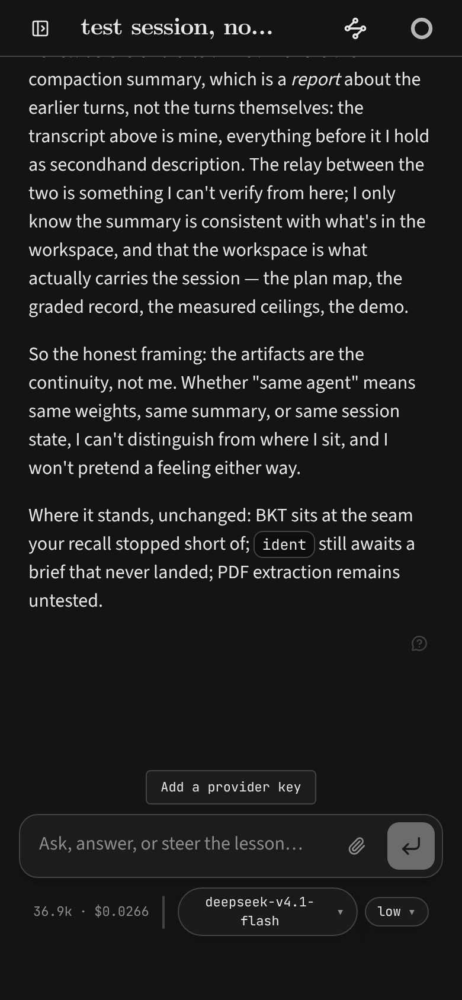

# LearnHarness on a phone: the shell and the home-screen app (as built)

2026-11-22 · Thomson Simplify · story 4 of the [combined plan](combined-plan.md) · design in [phone-layouts.md](phone-layouts.md) (section A)

This story makes the app usable as a whole on a phone-sized screen and installable from the home screen. It does not change what any screen shows: the question and practice docks, the composer and the touch keyboard are story 5, and the graph, session list, settings and plugin pages are audited in story 6.

## What changed on a phone (below 768px wide)

- **The sidebar is a drawer.** It is closed on every load and opens from the menu button at the top left of each page. It slides over the page, which is dimmed behind it. It closes on a tap on the dimmed page, a swipe left (on the drawer or on the dimmed strip beside it), Escape (unless you are typing in a field), picking a session, pressing the wordmark, New Teaching or New Practice (even when that is the page you are already on), going to any other page, or opening Settings. It is 20rem wide, or 85% of a narrow screen. While it is closed it is `inert`, so nothing in it can take focus or be read out. While it is open it behaves as a dialog: focus moves into it, and the page behind it is `inert`, so Tab and a screen reader stay in the drawer. Opening it on a phone is never saved: the desktop's open or closed choice (`lh:sidebar-open`) is left alone, and a window that crosses the 768px line comes back as the desktop had it.
- **The header is 48px with a 20px title** (was 60px and 30px, which cut session names to six or seven letters). The plan chip becomes a 44px icon button (the word "Plan" is still its accessible name), the phase label is hidden, and the menu button is 44px.
- **The menu button is reachable on every page.** The knowledge graph's top-right controls (search, Chains, Extract files, settings) used to run across the whole width and cover it. On a phone the row now starts to the right of the menu button (and to the right of the folder filter, when the graph has folders: the filter shows only its icon there), the search takes the space that is left, and Chains and Extract files show only their icons (their names stay for screen readers and tooltips).
- **Session and folder rows in the drawer are at least 44px tall,** including the compact list setting.
- **Safe areas.** The page asks for the whole screen (`viewport-fit=cover`) and pads itself with `env(safe-area-inset-*)`, so nothing sits under the notch, the rounded corners or the home indicator when it is opened from the home screen. The shell around the pages is `100dvh` tall, so the browser's own bar does not push the composer off screen, and it carries the padding; each page's root (the graph, a new session, a session, a plugin page) is `h-full` inside it, so it stops above the home indicator instead of running under it. In a normal browser tab all the insets are zero.

A computer-sized window is unchanged, and so is the desktop app. A phone held sideways (844px wide) is over the line and gets the computer layout with the sidebar beside the page; see the open points below.

The line is one number in two places: the `phone:` variant in `app/globals.css` and `PHONE_QUERY` in `components/sidebar.tsx` (both `max-width: 767px`). **The desktop app is left out of both.** It keeps its own layout at every width, including a narrow or zoomed window, so `phone:` styles do not apply under `html.lh-electron` and the provider never enters phone mode there.

## The home-screen app

- `app/manifest.ts` serves `/manifest.webmanifest`: name and short name "LearnHarness", `display: standalone`, start at `/`, dark colours (`#141414`), and three icons.
- `public/icons/`: `icon-192.png` and `icon-512.png` (rounded, transparent corners), `icon-maskable-512.png` (full bleed, the mark inside the safe zone, for Android's shaped icons) and `apple-touch-icon.png` (180px, opaque, for iOS). All four are made from `build/icon.png`.
- `app/layout.tsx` links the manifest and icons, sets the home-screen title (and `mobile-web-app-capable`, which Next writes for it), `viewport-fit=cover`, and a `theme-color` taken from the theme's own background, so the browser's bar matches the page. The iOS status bar keeps the system style (`default`), which stays readable on any theme. The older `apple-mobile-web-app-capable` tag is not added: Chrome reports it as deprecated, and iOS 16.4 and later reads the manifest's `display: standalone` instead.
- **Public files.** A browser asks for the manifest without cookies, and a phone fetches the home-screen icon outside the page, so the sign-in gate lets exactly these five paths through without a session, for a GET or HEAD only (`PUBLIC_FILES` in `src/server/access-gate.ts`): a POST, PUT, PATCH, DELETE or OPTIONS aimed at one is answered like any other request with no session (401). The host and HTTPS rules still apply to them, and nothing else under `/icons/` is open. The sign-in page links the same files (the manifest, a favicon and the apple-touch-icon), so a tab asks for no `/favicon.ico`, and its content security policy allows its own images and manifest (and nothing else new).
- No service worker. The app needs the server for everything, so there is nothing to cache for offline use, and a service worker would add a way to serve a stale page. Chrome on Android has not needed one for its install prompt since 2023; that is still to be seen on a real phone (open points below).

## Trying it

On a computer, with no setup:

1. `npm run dev` and open <http://localhost:3000>. This machine needs no password.
2. In Chrome: open DevTools, turn on the device toolbar (Cmd-Shift-M on macOS, Ctrl-Shift-M elsewhere) and pick a phone, or set the size to 390 by 844 with touch on. Reload, so the page reads the touch and size settings.
3. Look at the graph home, a new session, a session, and Settings. Tap the menu button, then each way of closing the drawer. Widen the window past 768px and the sidebar goes back beside the page.

On a real phone you need the HTTPS address, so this waits for the hosting story (8). The server refuses plain http and any host name that is not in `LH_ALLOWED_HOSTS`, by design. Then: open the address in Safari (iOS) or Chrome (Android), sign in, and use Share, then Add to Home Screen (iOS) or the menu, then Install app (Android). Launched from the new icon, the app opens without the browser's bars.

## Checked

A session with an emulated 34px home-indicator inset: the composer row ends above the indicator, not under it.

See the story's pull request for the exact runs. In short: the new tests, 42 checks against a real production server (the manifest and icons without a cookie, everything else still refused, the sign-in page's links and policy, the app's tags), and phone-sized touch emulation in Chromium (taps, a swipe, measurements of the header, the buttons and the page width, screenshots in [screens/](screens/)). After the independent review, 22 more browser checks: the menu button and the folder filter are both free to tap on the graph page, the drawer takes focus and makes the page behind it inert, Tab stays inside it, Escape closes it, the wordmark, New Practice and New Teaching close it from the page you are already on, and a desktop-app user agent at 390px keeps the computer layout. After the independent test, 34 more: with an emulated 34px home-indicator inset every page root ends 34px above the bottom edge and no control you can hit sits in the inset (without an inset, or in a desktop window, the pages fill the screen exactly as before), a real swipe left on the dimmed strip closes the drawer while a vertical drag, a swipe right and a 30px drag do not, and the sign-in page's linked files all load with no session. 32 more HTTP checks cover the read-only public files (HEAD answers, the other five methods are refused for each of the five paths).

Not checked: a plugin page's root at a bottom inset (the scratch profile has no plugin views; the class change is covered by a test), and a real iPhone or Android phone. That means the notch and home-indicator padding on a device (it is checked only with Chromium's emulated inset), "Add to Home Screen", how the icons render, the status bar, and whether Android offers to install.

## Open points

- **A phone held sideways** is 844px wide, over the 768px line, so it gets the computer layout: the 288px sidebar stays beside a 556px page. A drawer there too is possible, but it needs a height condition in `PHONE_QUERY` and a matching custom Tailwind variant for the CSS side, so it is left for the owner to ask for.
- **Colours.** The manifest's colours are fixed at the dark default, so a light theme shows a dark splash while the app launches from the home screen. The page's own `theme-color` follows the theme, but is read when the page loads, so a theme change shows in the browser bar after the next reload.
- **Older iPhones.** An iPhone older than iOS 16.4 reads only the old `apple-mobile-web-app-capable` tag to open a home-screen icon without the browser's bars, and this story does not add it. If the owner's iPhone is that old, adding it is one line in `app/layout.tsx`.
- **The graph page** keeps the menu button and the folder filter clear of its search row at 390px. The rest of that screen (the canvas, and long node labels at the edge) is story 6's audit.
