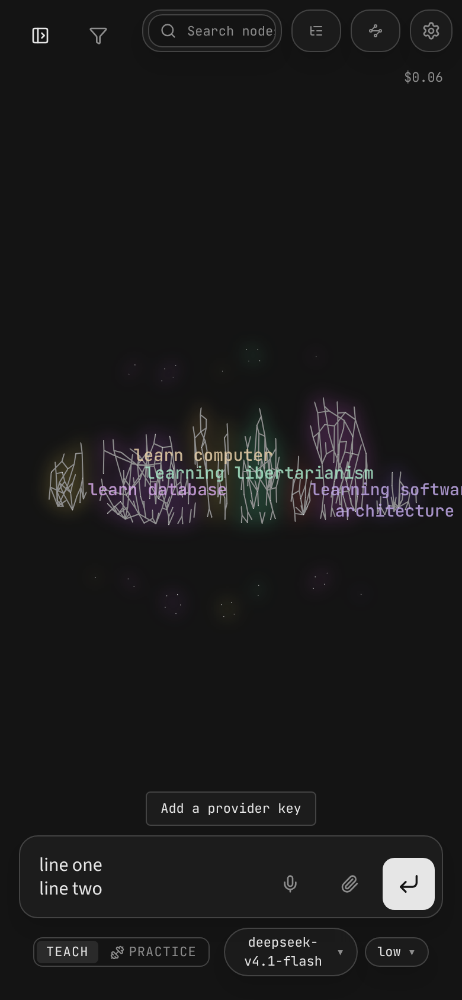
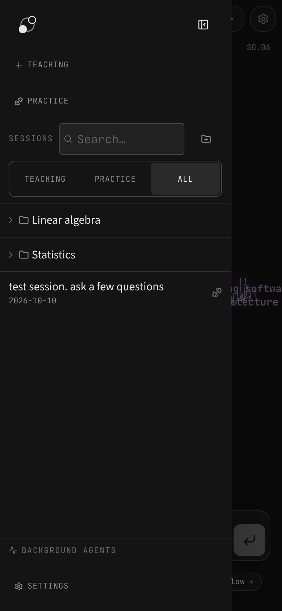
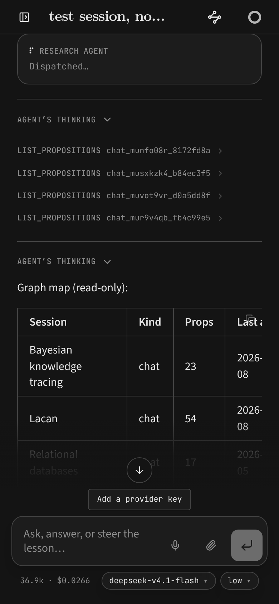

# LearnHarness on a phone: the touch keyboard and finger-sized controls (as built)

2026-11-22 · Thomson Simplify · story 5a of the [combined plan](combined-plan.md) · design in [phone-layouts.md](phone-layouts.md) · builds on [phone-shell.md](phone-shell.md)

This story makes typing and tapping work with a finger: Enter becomes a new line where the keyboard is on the screen, small controls get a 44px target, buttons that only appeared on hover are visible, and the microphone sits next to the field on a phone. It does not move any dock or panel: the question dock, the practice dock and the side question become bottom sheets in story 5b.

## What changed

- **Enter is a new line on an on-screen keyboard.** A phone's keyboard has no Shift+Enter, so in a field that sends on Enter there was no way to write a second line. Where the main pointer is a finger (`(pointer: coarse)`, so phones and tablets), Enter now makes a new line in every field that used to send on it: the composer on the home page, on a new session and in a session; both fields of the question dock; the practice dock; the side question; and the plugin question dock. The send button sends, and so does **Cmd or Ctrl+Enter**, for a keyboard attached to a tablet. A computer, or a tablet whose main pointer is a mouse or trackpad, keeps Enter to send and Shift+Enter for a new line. The rule is read when the key is pressed (`lib/touch-keyboard.ts`), so a window that moves between a touch screen and a mouse follows it.
- **The line beside Submit** (`components/enter-hint.tsx`) says which: "↵ submits · ⇧↵ newline" on a computer, "↵ new line" on a touch screen. Both are in the page and CSS shows the true one, so the server render and the first browser render agree.
- **A 44px target without a bigger look.** A new utility, `touch-target` (in `app/globals.css`), puts an invisible 44px area around a control that is smaller, only on a touch screen, and only in the directions in which the control is smaller. It is on the model, thinking and cost pills under the composer, the side-question button, the answer-dock buttons, the code-block copy and diagram-expand buttons, the reasoning toggles and the "Add a provider key" button. Buttons that can be a little bigger are: the send, attach and next-problem buttons (44px on a touch screen, 40px on a computer), the session title (a 44px target in the 48px header), and, on a phone, the drawer's own controls (Home, Close, Teaching, Practice, plugin actions such as Flashcards, search, Add folder, the filter tabs, Settings), which are 44px tall.
- **No hover needed.** The code-block copy button and the diagram expand button only showed when the mouse was over them. On a touch screen they are always visible.
- **The microphone on a phone.** The stats row under the composer has no room for the dictation strip at phone width, so there it is hidden and a mic button sits in the composer row, left of Attach (`DictationMic` in `components/dictation.tsx`). It records and stops like the strip, shows when it is recording, stopping or has failed, and, with no Deepgram key, clears the error and opens Settings instead, as the strip does. It is on the home, new session and session composers. There is no level meter on a phone, and the question and practice docks have no mic on a phone yet: their dictation strip is the one that is hidden, and they become bottom sheets in story 5b, which gives them one.
- **No zoom on focus.** iOS zooms a page when a field below 16px takes focus. The composers already use a 16px prose size on a phone; the drawer's search field is now 16px too.

Nothing changes at 768px or wider, with a mouse, or in the desktop app (its own layout, as in story 4).

## Where the code is

- `lib/touch-keyboard.ts`: `onScreenKeyboard()` and `enterMaySend(event)`. Every Enter-to-send handler calls `enterMaySend`; a test scans the source and fails if a new one does not.
- `components/enter-hint.tsx`, `components/composer.tsx`, `components/home.tsx`, `components/question-dock.tsx`, `components/practice-dock.tsx`, `components/side-thread.tsx`, `components/plugin-question-dock.tsx`.
- `app/globals.css` (`touch-target`), used by `attach-files-button.tsx`, `model-picker-pill.tsx`, `stats-bar.tsx`, `setup-cta.tsx`, `md-blocks.tsx`, `ai-elements/reasoning.tsx`, `chat.tsx` and the docks.
- `components/dictation.tsx` (`DictationMic`), `components/stats-bar.tsx` (the strip hides on a phone), `components/sidebar.tsx` and `components/plugin-chrome.tsx` (the drawer's sizes).
- `tests/touch-input.test.tsx` (14 tests).

A control that gets `touch-target` must be positioned (`relative`): the extra area is an `::after`. The area is clipped by an ancestor with `overflow: hidden`, and by the transcript's `content-visibility: auto` message wrappers, which paint only inside their own box. That is why the side-question button's row has extra padding on a touch screen: without it the 44px area was cut off on the right and underneath.

## Trying it

On a computer, as in [phone-shell.md](phone-shell.md): check out the branch, `npm run dev`, and open DevTools' device toolbar at 390 by 844 **with touch on** (that is what makes `(pointer: coarse)` true; a narrow window with a mouse does not). Reload after changing the device.

1. Home page: type in the composer, press Enter. A new line appears and nothing is sent. Press the arrow button: it sends. Type, press Cmd/Ctrl+Enter: it sends.
2. In a session, repeat. Open a question or practice dock and check the hint line says "↵ new line", and that Enter in the answer field adds a line.
3. Look under the composer: the mic sits left of Attach, and the cost, model and thinking pills are easy to tap (a finger just above or below them still hits them).
4. Scroll a teaching session with code in it: the copy buttons on code blocks are visible without hovering.
5. Open the drawer: every row and button is at least 44px tall, and focusing the search field does not zoom the page on iOS.
6. Turn touch off (or widen to 768px with a mouse): Enter sends again, the dictation strip is back in the stats row, and the controls are the sizes they were.

## Checked

See the story's pull request for the exact runs. In short: 14 new tests, and 43 checks in Chromium at 390 by 844 with touch against the production build: Enter adds a line and sends nothing on the home page and in a session, and sends on a computer; the mic, Attach and send buttons are 44px; the pills, the side-question button and a code-block copy button are reachable 18px beyond their edges; the copy and expand buttons are visible without hover and still wait for hover on a computer; every drawer control is at least 44px; the drawer search is 16px; and the computer layout is unchanged.

Not checked: a real iPhone or Android phone. That means the on-screen keyboard itself (the emulation changes only what the page can see), a Bluetooth keyboard on a tablet, iOS zoom on focus, and how the microphone permission prompt behaves in a home-screen app.

## Open points

- **Tablets count as touch screens.** An iPad has a coarse main pointer even with a keyboard attached, so Enter is a new line there, and Cmd+Enter sends. Say so if you would rather an iPad with a keyboard send on Enter.
- **A draft is lost** when the session ends and you sign in again: it lives only in the page.
- **No level meter** on the phone's mic button.
- **The side-question button** is a small, faint icon after each reply. It is now a proper touch target, but whether it is discoverable enough on a phone is for story 5b, where the side question becomes a bottom sheet.
