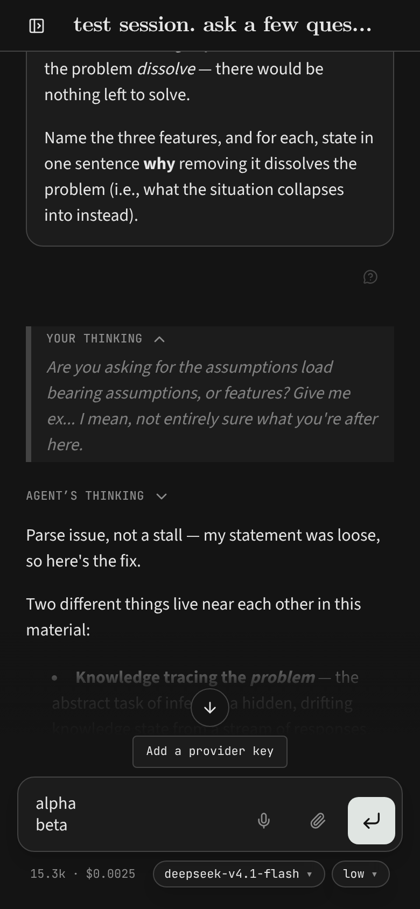
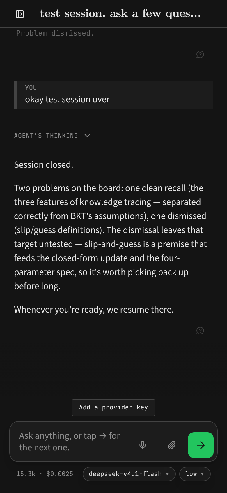
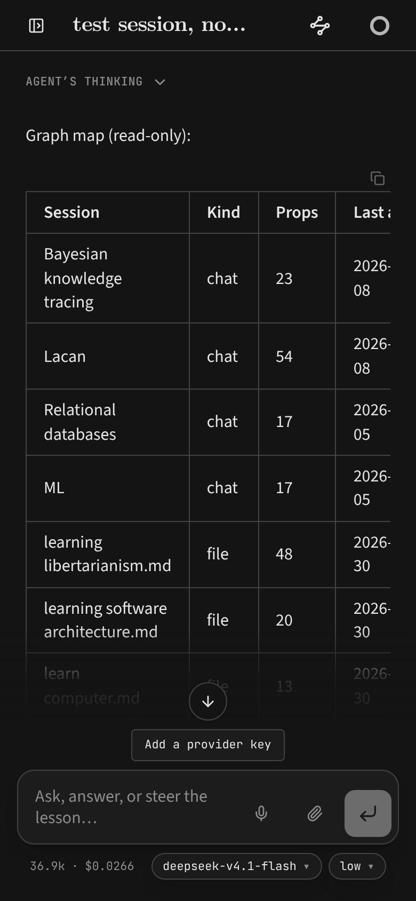
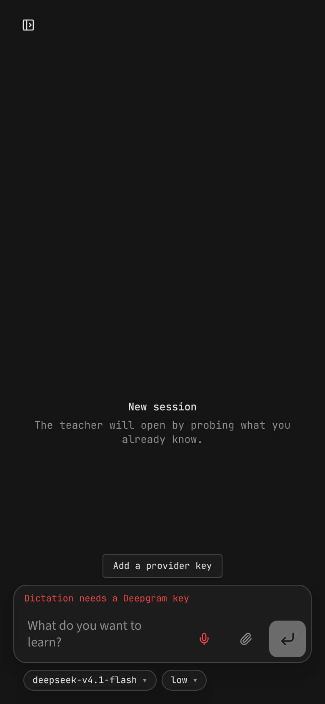

# LearnHarness on a phone: the touch keyboard and finger-sized controls (as built)

2026-11-22 · Thomson Simplify · story 5a of the [combined plan](combined-plan.md) · design in [phone-layouts.md](phone-layouts.md) · builds on [phone-shell.md](phone-shell.md)

This story makes typing and tapping work with a finger: Enter becomes a new line where the keyboard is on the screen, small controls get a 44px target, buttons that only appeared on hover are visible, and the microphone sits next to the field on a phone. It does not move any dock or panel: the question dock, the practice dock and the side question become bottom sheets in story 5b.

## What changed

- **Enter is a new line on an on-screen keyboard.** A phone's keyboard has no Shift+Enter, so in a field that sends on Enter there was no way to write a second line. Where the main pointer is a finger (`(pointer: coarse)`, so phones and tablets), Enter now makes a new line in every field that used to send or act on it: the composer on the home page, on a new session and in a session; both fields of the question dock; the "thinking while reading" field above a waiting check; the practice dock; the side question; the plugin question dock and, by the host's default, a plugin's own answer editor; and the citation comment box. The send button sends (the Save button saves a citation comment), and so does **Cmd or Ctrl+Enter**, for a keyboard attached to a tablet. The citation popover's "save and send" into a field asks it with a Ctrl+Enter, so it sends on a touch screen too. A computer, or a tablet whose main pointer is a mouse or trackpad, keeps Enter to send and Shift+Enter for a new line. The rule is read when the key is pressed (`lib/touch-keyboard.ts`), so a window that moves between a touch screen and a mouse follows it.
- **The line beside Submit** (`components/enter-hint.tsx`) says which: "↵ submits · ⇧↵ newline" on a computer, "↵ new line" on a touch screen. Both are in the page and CSS shows the true one, so the server render and the first browser render agree.
- **A 44px target without a bigger look.** A new utility, `touch-target` (in `app/globals.css`), puts an invisible 44px area around a control that is smaller, only on a touch screen, and only in the directions in which the control is smaller. It is on the model, thinking and cost pills under the composer, the side-question button, the Teach/Practice switch on the home page, the code-block copy and diagram-expand buttons, the reasoning toggles and the "Add a provider key" and "Set up your models" buttons. Buttons that can be a little bigger are: the send, attach and next-problem buttons (44px on a touch screen, 40px on a computer), the home page's Start button, the session title (a 44px target in the 48px header), and, on a phone, the drawer's own controls (Home, Close, Teaching, Practice, plugin actions such as Flashcards, search, Add folder, the filter tabs, Settings), which are 44px tall. The question and practice docks' own buttons (Submit and the like) are not changed here: they are rebuilt as bottom sheets in story 5b.
- **No hover needed.** The code-block copy button and the diagram expand button only showed when the mouse was over them. On a touch screen they are always visible. A table's copy button, which sits over the table's top-right corner with a mouse, moves into a row of its own above the table on a touch screen, so it never covers the last column's text (the other copy buttons still sit over their block's corner).
- **The practice pause on a phone.** Between problems the composer's wide green "Next problem" button, beside the mic and Attach, left the text field about 100px (70px at 360) with its hint wrapping over five lines. On a phone it is now the arrow alone, 44px square, and still named "Next problem" for a screen reader; the field keeps about 190px (160px at 360). The hint used to say "press Enter for the next one", which is not true on an on-screen keyboard (Enter is a new line there); on a touch screen it reads "Ask anything, or tap → for the next one." (`nextProblemPlaceholder`, chosen with `useOnScreenKeyboard()`, which says "computer" in the server render and then follows the device). A tablet keeps the words on the button.
- **The thinking toggle is a real 44px row on a touch screen** ("AGENT'S THINKING"), not an invisible 44px area: the transcript's message wrappers cut an overhang off at their edges, and the toggle is usually at the top of one.
- **The microphone on a phone.** The stats row under the composer has no room for the dictation strip at phone width, so there it is hidden and a mic button sits in the composer row, left of Attach (`DictationMic` in `components/dictation.tsx`). It records and stops like the strip, shows when it is recording, stopping or has failed, and, with no Deepgram key, clears the error and opens Settings instead, as the strip does. It is on the home, new session and session composers. If dictation fails (no key, a refused microphone permission), the reason shows as a red line above the composer, because the strip that used to say so is hidden. There is no level meter on a phone, and the question and practice docks have no mic on a phone yet: their dictation strip is the one that is hidden, and they become bottom sheets in story 5b, which gives them one.
- **No zoom on focus.** iOS zooms a page when a field below 16px takes focus. The composers already use a 16px prose size on a phone; the drawer's search field is now 16px too.

Nothing changes at 768px or wider, with a mouse, or in the desktop app (its own layout, as in story 4).

## Where the code is

- `lib/touch-keyboard.ts`: `onScreenKeyboard()`, `useOnScreenKeyboard()` (for text that names a key), `enterMaySend(event)` and `SEND_KEY_INIT` (the synthetic Ctrl+Enter). Every Enter-to-send handler calls `enterMaySend`. A test lists every source file under `components`, `lib` and `src` that handles the Enter key, and fails for one that is in neither its "asks first" list (it must call `enterMaySend`) nor its "elsewhere" list (single-line fields, menus and window-level listeners that skip typing surfaces), so a new field has to be classified.
- `components/enter-hint.tsx`, `components/composer.tsx`, `components/home.tsx`, `components/question-dock.tsx`, `components/practice-dock.tsx`, `components/side-thread.tsx`, `components/plugin-question-dock.tsx`, `components/reading-thinking.tsx`, `components/plugin-question-keys.ts`, `components/citation-comment-editor.tsx`.
- `app/globals.css` (`touch-target`), used by `attach-files-button.tsx`, `model-picker-pill.tsx`, `stats-bar.tsx`, `setup-cta.tsx`, `md-blocks.tsx`, `ai-elements/reasoning.tsx`, `chat.tsx` and the docks.
- `components/dictation.tsx` (`DictationMic`), `components/stats-bar.tsx` (the strip hides on a phone), `components/sidebar.tsx` and `components/plugin-chrome.tsx` (the drawer's sizes).
- `tests/touch-input.test.tsx` (24 tests).

A control that gets `touch-target` must be positioned (`relative`): the extra area is an `::after`. The area is clipped by an ancestor with `overflow: hidden`, and by the transcript's `content-visibility: auto` message wrappers, which paint only inside their own box. That is why the side-question button's row has extra padding on a touch screen (without it the 44px area was cut off on the right and underneath), and why the thinking toggle has a real height. The copy and expand buttons that sit in the far top-right corner of a block still lose part of their extra area on the right: they stay a 24px button plus about 10px on the other sides (see the open points).

## Trying it

On a computer, as in [phone-shell.md](phone-shell.md): check out the branch, `npm run dev`, and open DevTools' device toolbar at 390 by 844 **with touch on** (that is what makes `(pointer: coarse)` true; a narrow window with a mouse does not). Reload after changing the device.

1. Home page: type in the composer, press Enter. A new line appears and nothing is sent. Press the arrow button: it sends. Type, press Cmd/Ctrl+Enter: it sends.
2. In a session, repeat. Open a question or practice dock and check the hint line says "↵ new line", and that Enter in the answer field adds a line.
3. Look under the composer: the mic sits left of Attach, and the cost, model and thinking pills are easy to tap (a finger just above or below them still hits them).
4. Scroll a teaching session with code in it: the copy buttons on code blocks are visible without hovering.
5. Open the drawer: every row and button is at least 44px tall, and focusing the search field does not zoom the page on iOS.
6. Turn touch off (or widen to 768px with a mouse): Enter sends again, the dictation strip is back in the stats row, and the controls are the sizes they were.

## Checked

See the story's pull request for the exact runs. In short: 24 new tests, and 43 plus 34 checks in Chromium at 390 by 844 with touch against the production build (the second set is the follow-up to the independent test: the practice pause at 390 and 360 wide, on a tablet and on a computer; the mic's reason with a fake microphone and no key, and the second tap opening Settings; every table's copy button above its table; every thinking toggle 44px tall on a touch screen and unchanged on a computer). In the first set: Enter adds a line and sends nothing on the home page and in a session, and sends on a computer; the mic, Attach and send buttons are 44px; the pills, the side-question button and a code-block copy button are reachable 18px beyond their edges; the copy and expand buttons are visible without hover and still wait for hover on a computer; every drawer control is at least 44px; the drawer search is 16px; and the computer layout is unchanged.

Not checked: a real iPhone or Android phone. That means the on-screen keyboard itself (the emulation changes only what the page can see), a Bluetooth keyboard on a tablet, iOS zoom on focus, and how the microphone permission prompt behaves in a home-screen app.

## Open points

- **A touch-primary computer running the desktop app** (a Windows tablet or convertible whose main pointer is a finger) also gets these behaviours, because `pointer-coarse:` is not switched off under `html.lh-electron` the way the `phone:` variant is. That is the right behaviour for an on-screen keyboard; say so if the desktop app should never change.

- **Tablets count as touch screens.** An iPad has a coarse main pointer even with a keyboard attached, so Enter is a new line there, and Cmd+Enter sends. Say so if you would rather an iPad with a keyboard send on Enter.
- **Copy buttons at a block's far right edge** (code, equation, diagram, and the expand button) are 24px with about 10px of extra area on three sides: the message wrapper cuts the fourth off. They are visible and tappable; a bigger area would need a toolbar row like the table's. On a touch screen they also sit over the first line's end of a long code line.
- **The model pill can wrap to two lines** on the home page at 390 and in a session at 360, because its name is long. It was like that before this story.
- **A draft is lost** when the session ends and you sign in again: it lives only in the page.
- **No level meter** on the phone's mic button.
- **The side-question button** is a small, faint icon after each reply. It is now a proper touch target, but whether it is discoverable enough on a phone is for story 5b, where the side question becomes a bottom sheet.
